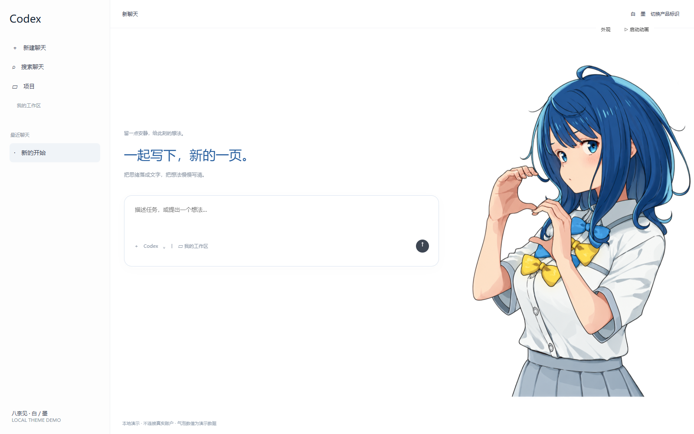
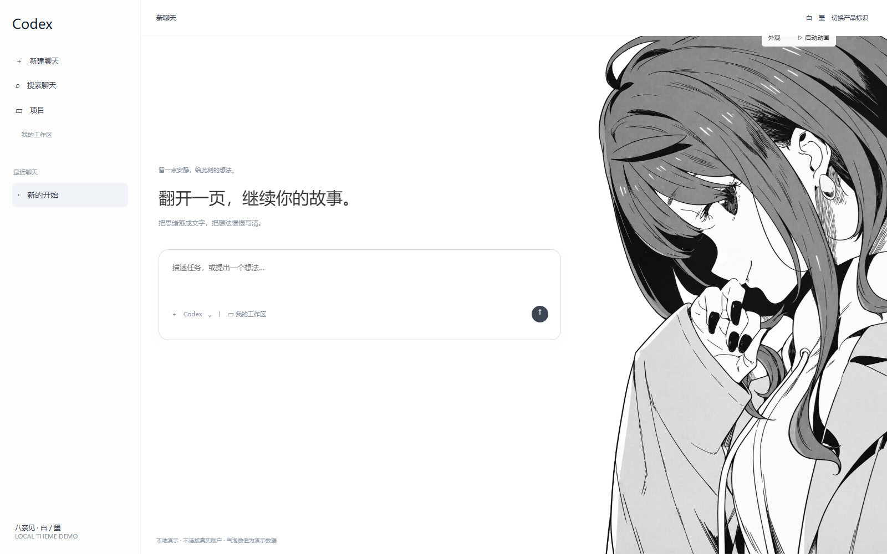

# 八奈见 · 白 / 墨

Anna Yanami inspired startup animations and desktop themes for ChatGPT / Codex on Windows.

以八奈见杏菜为主题的两套开屏与界面美化。白底、右侧人物、原生聊天区，支持人物切换和点击人物查看 Codex 用量。

> **实验性版本 · v0.1.0-alpha.1**。已取消后台关闭、重启客户端的机制，改由同一个入口一次启动官方应用；完整冷启动仍需实际验证。请先看 [兼容性与已知问题](docs/KNOWN_ISSUES.md)，不要把本地演示视为安装成功。

## 效果

| 白 · WHITE | 墨 · INK |
|---|---|
|  |  |

图片为无真实聊天内容的本地演示。人物插图及第三方库不适用本项目代码的 MIT 许可证，见 [素材说明](assets/NOTICE.md) 与 [第三方说明](THIRD_PARTY_NOTICES.md)。

## 功能

- 白 / 墨两种开屏，人物与聊天区右侧衔接。
- 七张本地人物图，无损 WebP；不下载远程壁纸。
- 保留原生输入、侧栏、项目和聊天功能；窄窗口自动收起人物。
- 外观面板可切换主题、人物、标识、清晰度和轻微呼吸动态。
- 点击人物显示带尾巴的用量气泡；真实安装中只读 Codex 账户额度。
- ChatGPT / Codex 标识跟随当前可识别的产品模式，也可手动指定。
- 将现有固定图标指向统一入口，不再先开原版再重启。
- 当前用户后台任务只接入主题，连接失败不会关闭或重启客户端。
- 客户端更新后，校验官方包身份与签名，再自动刷新版本路径。

## 先预览

需要 Node.js 22 或更新版本。下载并解压整个项目，双击 `Preview.cmd`，打开：

```text
http://127.0.0.1:5177/
```

这是本地演示，不安装主题，也不读取真实账户；演示气泡使用明确标注的假数据。按 Ctrl+C 关闭预览服务。

## 安装

1. 安装并登录官方 Microsoft Store ChatGPT / Codex Windows 客户端。
2. 保存工作，完整退出客户端。
3. 解压整个项目，在普通用户会话中双击 `Install.cmd`。
4. 用安装目录内的 `ChatGPT.lnk` 替换原来固定的开始菜单 / Nexus 图标。具体见操作说明。
5. 从替换后的图标启动。客户端右上方出现“外观 / 启动动画”后可调整主题。

安装程序不会更改 WindowsApps、app.asar、签名、聊天记录或登录信息；在安装目录内生成供替换使用的快捷方式。未替换的商店原入口、搜索结果和任务栏入口，冷启动时仍可能没有主题；后台不会为此重启应用。

详细步骤、预检、卸载及更新：[操作说明](docs/OPERATIONS.md)。

## 卸载

双击 `Uninstall.cmd`。它只停止本项目后台任务并移除当前窗口主题，不卸载官方客户端。程序文件及诊断数据保留以便备份；需要时再手动删除安装目录。

## 开发

```text
node scripts/check.cjs
node scripts/check-client-binding.cjs
node scripts/preview.cjs
node scripts/package.cjs
```

不需要 npm 依赖安装。GSAP 3.12.2 的原始压缩文件随仓库保留其版权头和独立许可说明。

| 目录 | 内容 |
|---|---|
| `src/` | 主题、开屏编排、只读用量桥和后台恢复程序 |
| `assets/` | 人物素材、清单和素材说明 |
| `native/` | Windows 连接检查与窗口激活辅助程序的 C# 源码 |
| `scripts/` | 恢复、校验、预览与打包工具 |
| `preview/` | 不连接真实账户的独立演示页面 |
| `vendor/` | 保留原许可的第三方 GSAP 文件 |
| `docs/` | 操作说明、兼容性、架构与发布说明 |

## 许可与反馈

原创程序代码采用 [MIT](LICENSE)。人物、作品名称、原作插图、第三方库及其商标保留各自权利，不能把整仓库的所有文件都视为 MIT 素材。

这是非官方个人主题项目，与 OpenAI、原作出版方或插画作者无隶属关系。提交问题时请按 [排查说明](docs/KNOWN_ISSUES.md) 提供脱敏信息，不上传聊天、账户或整个状态目录。
